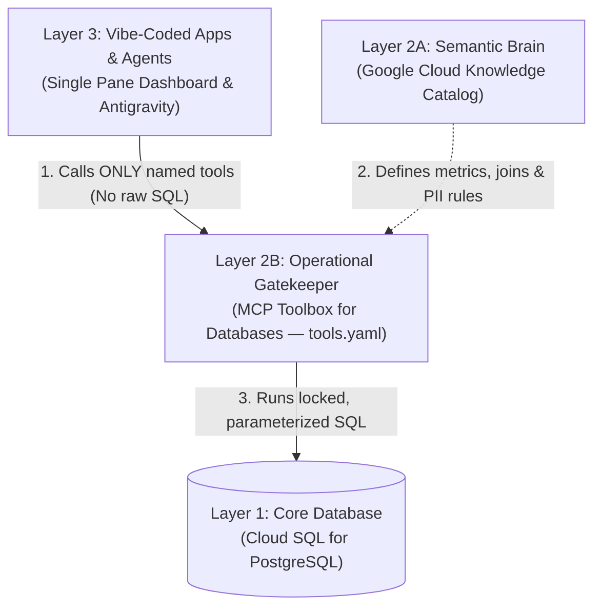

# Governed Context Layer on Google Cloud (`governed-context-layer-gcp`)

Companion codebase for the 2-part tutorial series **"Building a Governed Context Layer for AI Apps on Google Cloud: Cloud SQL for PostgreSQL, Knowledge Catalog, MCP Toolbox for Databases & Model Armor"** (inspired by Rod Johnson's article *[Vibe Coding, Meet Reality](https://medium.com/@springrod/vibe-coding-meet-reality-0fb1e4e04053)*).

This repository demonstrates how to build a **3-Layer Governed Semantic, Security & Operational Context Architecture** on Google Cloud for **Chai & Co.** (an Indian Tea Shop franchise operating across **Mumbai**, **Bengaluru**, and **Delhi**) so developers and domain experts can rapidly generate "Single Pane of Glass" dashboards and AI agents without leaking customer PII or hallucinating business metrics.

---

## Architecture Overview



---

## Prerequisites & Google Cloud APIs

1. **Google Cloud Project with Billing Enabled**
2. **Enable Required Google Cloud APIs**:
   ```bash
   export GOOGLE_CLOUD_PROJECT="$(gcloud config get-value project)"

   gcloud services enable \
     sqladmin.googleapis.com \
     dataplex.googleapis.com \
     datacatalog.googleapis.com \
     aiplatform.googleapis.com \
     --project="$GOOGLE_CLOUD_PROJECT"
   ```
3. **Authenticate `gcloud` and Application Default Credentials (ADC)**:
   ```bash
   gcloud auth login
   gcloud auth application-default login
   gcloud config set project "$GOOGLE_CLOUD_PROJECT"
   ```
4. **Local Tools**:
   - **Google Antigravity**
   - **Node.js (v18+) & `npx`** (for `@toolbox-sdk/server`)
   - **Python 3.12+** and **[`uv`](https://docs.astral.sh/uv/)**

---

## Repository Layout

| File | Purpose |
| :--- | :--- |
| [`sql/01_schema_and_seed.sql`](./sql/01_schema_and_seed.sql) | Cloud SQL for PostgreSQL schema & seed data for *Chai & Co.* (`stores`, `customers`, `orders`, `suppliers`, `tea_inventory`, `restock_requests`). |
| [`tools.yaml`](./tools.yaml) | Declarative **MCP Toolbox for Databases** configuration (`cloud-sql-postgres` + `google-oidc` `authServices`) exposing governed, parameterized, PII-masked SQL tools. |
| [`antigravity_mcp_config.json`](./antigravity_mcp_config.json) | Sample MCP configuration for Google Antigravity (`~/.gemini/config/mcp_config.json`) wiring up `datacloud_knowledge_catalog_remote` and `mcp-toolbox-for-databases`. |
| [`single_pane_app.py`](./single_pane_app.py) | FastAPI **Single Pane of Glass** dashboard (`Morning Franchise Pulse`) with zero database drivers/SQL + `verify_no_direct_db_access()` AST static boundary verifier. |
| [`context_layer_gateway.py`](./context_layer_gateway.py) | Python gateway implementing Part 2 enterprise guardrails: **Model Armor + Cloud DLP** (`ModelArmorGuard`), **OIDC row-level auth**, **Agent Registry verification**, **Multi-Hop Supply Chain traversal**, and **Cloud Armor rate limiting** (`EdgeRateLimiter`). |
| [`knowledge_catalog_setup.py`](./knowledge_catalog_setup.py) | Reference helper for **Google Cloud Knowledge Catalog** (`lookup_context` YAML and **BigQuery Property Graph `CREATE PROPERTY GRAPH` & ISO GQL** DDL). |
| [`test_context_layer_blog.py`](./test_context_layer_blog.py) | Automated 11-test verification suite covering naive vs. governed queries and all 5 real-world production gaps. |

---

## Step-by-Step Cloud SQL & MCP Toolbox Setup

### 1. Create the Cloud SQL for PostgreSQL Instance & Seed via Cloud SQL Studio

```bash
export GOOGLE_CLOUD_PROJECT="$(gcloud config get-value project)"
export CLOUD_SQL_INSTANCE="chai-and-co-pg"
export CLOUD_SQL_REGION="asia-south1"

gcloud sql instances create "$CLOUD_SQL_INSTANCE" \
  --database-version=POSTGRES_16 \
  --edition=ENTERPRISE \
  --tier=db-f1-micro \
  --region="$CLOUD_SQL_REGION" \
  --project="$GOOGLE_CLOUD_PROJECT" \
  --quiet

gcloud sql databases create chai_and_co \
  --instance="$CLOUD_SQL_INSTANCE" \
  --project="$GOOGLE_CLOUD_PROJECT" \
  --quiet
```

Open **Cloud SQL Studio** in the Google Cloud Console (`chai-and-co-pg` -> `chai_and_co`), paste the contents of [`sql/01_schema_and_seed.sql`](./sql/01_schema_and_seed.sql), and click **Run**.

### 2. Verify Auto-Discovered Tables in Google Cloud Knowledge Catalog

```bash
gcloud dataplex entries search "system=CLOUD_SQL chai-and-co-pg" \
  --project="$GOOGLE_CLOUD_PROJECT"
```

### 3. Run MCP Toolbox for Databases Locally

```bash
npx -y @toolbox-sdk/server@latest --config=tools.yaml --stdio
```

---

## Quickstart (Run Dashboard & Automated Tests Locally in 30 Seconds)

```bash
# 1. Install dependencies
uv sync

# 2. Run the full 11-test verification suite
uv run python test_context_layer_blog.py

# 3. Launch the Single Pane of Glass web dashboard on http://127.0.0.1:8011
uv run python single_pane_app.py
```
