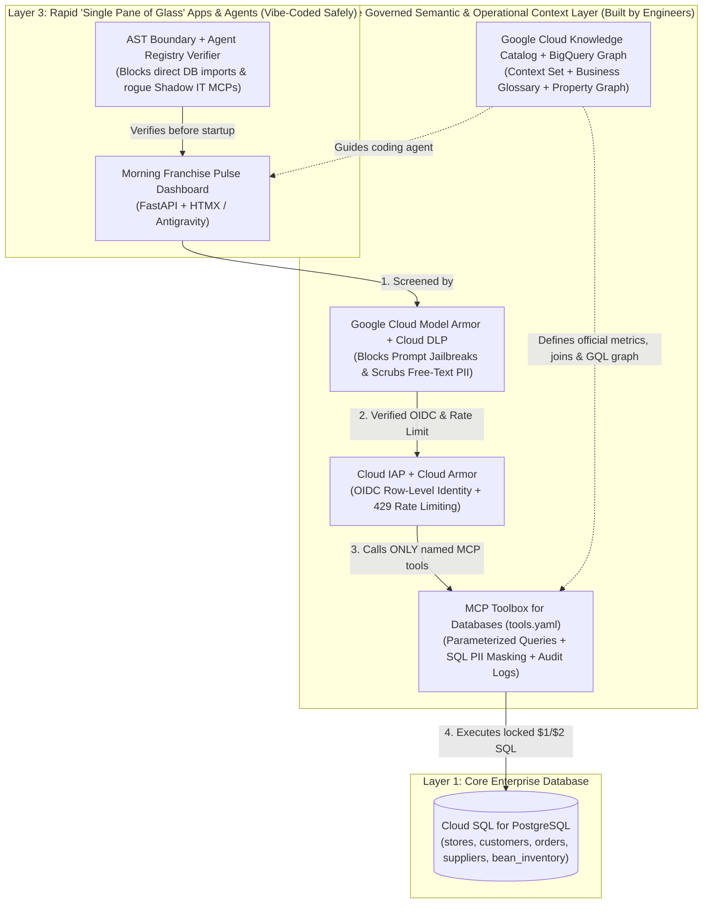

# Governed Context Layer on Google Cloud (`governed-context-layer-gcp`)

Companion codebase for **"Vibe Coding, Meet Reality: Building a Governed Context Layer with Cloud SQL for PostgreSQL, Google Cloud Knowledge Catalog, and MCP Toolbox for Databases"** (inspired by Rod Johnson's article *[Vibe Coding, Meet Reality](https://medium.com/@springrod/vibe-coding-meet-reality-0fb1e4e04053)*).

This repository demonstrates how to build a **3-Layer Governed Semantic, Security & Operational Context Architecture** on Google Cloud so developers and domain experts can rapidly generate "Single Pane of Glass" dashboards and AI agents without leaking customer PII or hallucinating business metrics.

---

## Architecture Overview



---

## Repository Layout

| File | Purpose |
| :--- | :--- |
| [`sql/01_schema_and_seed.sql`](./sql/01_schema_and_seed.sql) | Cloud SQL for PostgreSQL schema & seed data for *Roast & Co.* (`stores`, `customers`, `orders`, `suppliers`, `bean_inventory`, `restock_requests`). |
| [`knowledge_catalog_setup.py`](./knowledge_catalog_setup.py) | Builds the **Google Cloud Knowledge Catalog** Context Set (`type="context-set"`), Business Glossary & Table Entries (`upsert_entry`), `schema-join` links (`upsert_entry_link`), `lookup_context` YAML simulation, and **BigQuery Property Graph (`CREATE PROPERTY GRAPH` & ISO GQL)** DDL. |
| [`tools.yaml`](./tools.yaml) | Declarative **MCP Toolbox for Databases** configuration (`cloud-sql-postgres` + `google-oidc` `authServices`) exposing 5 governed, parameterized, PII-masked tools. |
| [`context_layer_gateway.py`](./context_layer_gateway.py) | Runnable Python gateway comparing Naive Direct-to-DB SQL against the Governed Context Layer, plus **Model Armor + Cloud DLP** (`ModelArmorGuard`), **OIDC row-level auth**, **Agent Registry verification**, **Multi-Hop Supply Chain traversal**, and **Cloud Armor rate limiting** (`EdgeRateLimiter`). |
| [`roast_context_mcp_server.py`](./roast_context_mcp_server.py) | Local MCP server for **Google Antigravity Manager** exposing the Knowledge Catalog lookup, Model Armor prompt screening, and governed database tools for natural-language queries. |
| [`antigravity_mcp_config.json`](./antigravity_mcp_config.json) | Sample MCP configuration for Google Antigravity Manager (`~/.gemini/antigravity/mcp_config.json`). |
| [`single_pane_app.py`](./single_pane_app.py) | FastAPI **Single Pane of Glass** dashboard (`Morning Franchise Pulse`) with zero database drivers/SQL + `verify_no_direct_db_access()` AST static boundary verifier. |
| [`test_context_layer_blog.py`](./test_context_layer_blog.py) | Automated 11-test verification suite covering naive vs. governed queries and all 5 real-world production gaps. |

---

## Quickstart (Run Locally in 30 Seconds)

Prerequisites: **Python 3.12+** and **[`uv`](https://docs.astral.sh/uv/)**.

```bash
# 1. Install dependencies
uv sync

# 2. Run the side-by-side Naive Direct-to-DB vs. Governed Context Layer comparison
uv run python context_layer_gateway.py

# 3. Inspect the Google Cloud Knowledge Catalog `lookup_context` YAML summary
uv run python knowledge_catalog_setup.py

# 4. Run the full 11-test verification suite
uv run python test_context_layer_blog.py

# 5. Launch the Single Pane of Glass web dashboard on http://127.0.0.1:8011
uv run python single_pane_app.py
```
